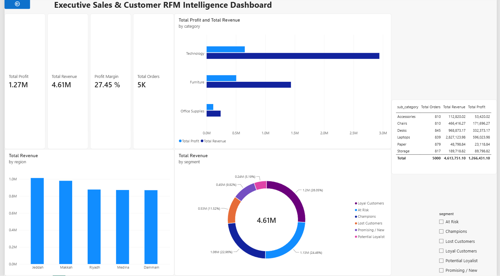

# Executive Sales & Customer RFM Intelligence Dashboard

An end-to-end Business Intelligence project analyzing retail transactions and automating customer segmentation via the RFM (Recency, Frequency, Monetary) methodology.

## Project Overview
This project delivers a multi-dimensional analytics solution designed to give executives clear visibility into revenue trends, product margins, and customer retention dynamics across key regional markets.

## Key Highlights & Architecture
- **Data Engineering & Pipeline:** Automated RFM scoring and transaction processing using **Python (Pandas)** and **SQL** (Window Functions: `NTILE`, `DATEDIFF`).
- **Data Modeling:** Modeled in **Power BI** using a **Star Schema** architecture linking fact sales to customer behavioral dimensions.
- **DAX Calculations:** Dynamic measures for Total Revenue, Gross Profit Margin (27.45%), AOV, and Order Volume.
- **Reporting Deliverables:** Interactive Power BI Dashboard (`.pbix`) and executive spreadsheet workbook (`.xlsx`).

## Behavioral Segmentation Framework
Customers are classified into 6 actionable tiers:
* **Champions:** Top buyers with highest recency, order frequency, and monetary spend.
* **Loyal Customers:** Frequent buyers with steady lifetime value.
* **Potential Loyalist / Promising:** Recent shoppers with high growth potential.
* **At Risk:** High-value customers showing signs of inactivity.
* **Lost Customers:** Long dormant accounts requiring re-engagement campaigns.

## Repository Contents
* `Executive Sales & Customer Intelligence Dashboard.pbix`: Power BI interactive dashboard.
* `Executive_Sales_and_RFM_Dashboard.xlsx`: Excel multi-tab analytical model.
* `rfm_queries.sql`: SQL scripts utilizing CTEs and analytical window functions.
* `rfm_pipeline.py`: Automated Python data pipeline.
* `sales_data.csv`: Transactional fact dataset (5,000 orders).
* `rfm_customer_segments.csv`: Customer-level RFM metrics and assigned segments.
